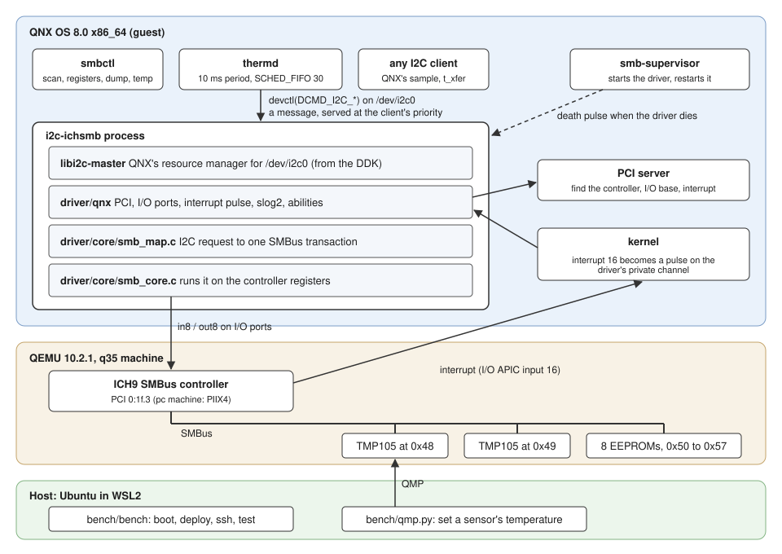

# i2c-ichsmb: SMBus for QNX 8.0 on Intel PCs, testable without hardware

A QNX OS 8.0 I2C driver for the SMBus controller in Intel PC chipsets, built on the QNX I2C Driver Development Kit, with a QEMU bench that lets you test it, and your own I2C code, before there's a board on the desk.

Tutorial: [Write and test a QNX 8.0 I2C driver without hardware](https://rayyankah.github.io/i2c-ichsmb/codelab/i2c-driver-without-hardware/) (source in `codelab/`).

## Quick start

You need QNX SDP 8.0 (free with a [QNX Everywhere](https://www.qnx.com/products/everywhere/) licence) installed under `~/qnx800`, on x86_64 Ubuntu, native or in WSL2. Install the packages QEMU needs to build:

```
sudo apt install git build-essential ninja-build meson pkg-config libglib2.0-dev \
    libpixman-1-dev libslirp-dev python3-venv flex bison libfdt-dev zlib1g-dev \
    curl xz-utils gpg
```

Then:

```
git clone https://github.com/rayyankah/i2c-ichsmb.git
cd i2c-ichsmb
source ~/qnx800/qnxsdp-env.sh
bench/bench up      # the first time this also builds QEMU (20 to 40 minutes) and a QNX image
bench/bench test
```

`up` ends with a scan of the bus: two temperature sensors (0x48, 0x49) and eight EEPROMs (0x50 to 0x57). `test` runs the on-target suite against the running guest and ends with a line like `64 cases, 64 passed, 0 failed, 100 s`. `bench/bench down` stops the guest.

## What this is and why

Every Intel PC chipset has an SMBus, the two-wire bus that connects memory-module EEPROMs, temperature sensors, fan controllers and battery or power-supply chips. QNX runs on Intel-based industrial and embedded PCs, but the QNX SDP 8.0 kit has no I2C driver for x86_64 at all, only the driver kit for writing one. Without a driver there's no `/dev/i2c0`, and those chips can't be reached.

There's a second problem every embedded developer knows: I2C code can't be tested until the board arrives, and its failure cases (a chip missing, a sensor overheating) are hard to produce even then. QEMU emulates the same Intel controller and can attach emulated chips to it. So one project answers both: a driver for the controller, and a bench that boots QNX in QEMU with sensors whose values you change from the host while QNX runs.



- `i2c-ichsmb` finds the controller through the QNX PCI server and serves the standard `/dev/i2c0`. Any program written for the QNX I2C interface works with it unchanged; QNX's own published I2C sample does (`docs/results/qnx-sample.txt`).
- It supports the two controllers QEMU emulates, ICH9 (`q35` machine) and PIIX4 (`pc`), in polling or interrupt mode. The controller can only run fixed SMBus transactions, so the driver maps each I2C request to the one transaction that puts exactly the same bytes on the wire, and refuses requests it can't do exactly (`driver/core/smb_map.c`, `docs/DESIGN.md`).
- It can drop root after start-up and keep only the abilities it still needs (`-U`).
- `smbctl` scans the bus, reads and writes registers, dumps EEPROMs, reads temperatures and watches a register.
- `thermd` is a real-time temperature monitor with a 10 ms deadline, `hog` a load generator, and `smb-supervisor` restarts the driver if it dies (`demo/README.md`).

## Build and run

| | |
|---|---|
| QNX version | QNX SDP 8.0 (8.0.0), base install from the QNX Software Center; no extra packages. The guest reports `QNX 8.0.0 2026/10/30` from `uname -a`. |
| Target | QNX OS 8.0 x86_64 image built by `mkqnximage --type=qemu`, run in QEMU 10.2.1 on the `q35` machine (ICH9 SMBus) or the `pc` machine (PIIX4), with KVM when available. Not tested on physical hardware. |
| Toolchain | `qcc -Vgcc_ntox86_64` from the SDP (gcc 12.2.0), GNU make. Host tests: any C99 compiler. Bench and test runner: Python 3, standard library only. |
| Host | Tested on Ubuntu 26.04 in WSL2 on Windows 11. |

Ubuntu's own QEMU has no I2C sensor models for x86, so `bench/qemu/build-qemu.sh` downloads QEMU 10.2.1, checks its signature, switches on the TMP105, TMP421, EMC1413 and AT24C models and installs it to `~/work/qemu`. `bench/bench up` runs it when that QEMU is missing, then builds the QNX image in `~/work/qnx-image` (making `~/.ssh/id_ed25519` first if you don't have one). Paths and the machine type are in `bench/config.env`; `MACHINE=pc bench/bench up` gives the PIIX4 controller.

Building by hand:

```
source ~/qnx800/qnxsdp-env.sh
make qnx                 # driver, smbctl, test client, demo programs
```

Starting the driver on the guest (as root; `bench/bench driver [OPTIONS]` does this for you):

```
/tmp/i2c-ichsmb -I 16              # q35: interrupt mode on interrupt 16
/tmp/i2c-ichsmb -I 16 -U qnxuser   # same, then run as qnxuser
/tmp/i2c-ichsmb                    # polling (the only mode on PIIX4)
```

`use /tmp/i2c-ichsmb` lists every option. On `q35` the interrupt has to be given with `-I 16`, because the image's PCI server reports one that never fires (`docs/DESIGN.md`, Which interrupt). Logs go to slog2: `slog2info -b i2c_ichsmb`, with `-vv` for everything.

## Using it

Commands run on the guest; `bench/bench ssh COMMAND` runs one from the host.

```
# /tmp/smbctl temp 0x48
0.0000 C (raw 0x0000)
```

From the host, set the emulated sensor to 91 C, and read it again:

```
$ bench/bench heat 0x48 91
0x48  91.000 C
# /tmp/smbctl temp 0x48
91.0000 C (raw 0x5b00)
# /tmp/smbctl -j temp 0x48
{"addr":72,"celsius":91.0000,"raw":23296}
# /tmp/smbctl set 0x50 0 0x41
# /tmp/smbctl get 0x50 0
0x41
# /tmp/smbctl get 0x30 0
smbctl: get: no acknowledge
```

`use /tmp/smbctl` lists the commands (`scan`, `get`, `set`, `getw`, `setw`, `read`, `write`, `recv`, `dump`, `temp`, `watch`, `info`). `bench/bench scenario bench/scenarios/overheat.txt` plays a script of temperature steps and ramps.

The demo programs and the measurements behind them are in `demo/README.md`. A short `thermd` run:

```
# /tmp/thermd -t 3
thermd: 2 sensor(s) every 10000 us, deadline 10000 us, threshold 80.0 C, priority 30 FIFO
...
deadline 10000 us: 0 missed, of which 0 periods had no wake-up at all
```

## Tests and results

| Suite | How to run | Needs |
|---|---|---|
| Host tests: `driver/core` against a software model of the controller, including the timeout, bus-error and busy paths QEMU can't produce | `make host-test` | any C99 compiler |
| Bare-metal test: the same core on QEMU's ICH9 controller, no QNX | `bash tests/baremetal/run.sh` | `gcc-mingw-w64-x86-64 qemu-system-x86 ovmf` |
| On-target tests, q35 (ICH9) | `make test` (boots its own guest) or `bench/bench test` | QNX SDP, the bench's QEMU |
| On-target tests, pc (PIIX4) | `make test-pc` | same |
| Evidence table still points at the right lines | `python3 tests/check_evidence.py` | Python 3 |

CI runs the host tests, the bare-metal test and the evidence check on every push (`.github/workflows/ci.yml`). The on-target tests need a QNX licence, so they run locally; their recorded output is in `docs/results/`.

Every number below comes from a file in `docs/results/`, collected in `docs/RESULTS.md` by `bench/collect_results.sh`. Times are measured inside QEMU and are emulated, not what a board would show.

| What | Result |
|---|---|
| On-target tests | q35: all 64 pass. pc: all 54 pass. |
| Host tests | 32 cases, 266 checks, 0 failed |
| QNX's I2C sample library against this driver | 6 of 6 checks |
| `thermd` at priority 30, `hog` spinning at 20 on every processor, 60 s | 10 of 6000 deadlines missed |
| Same, `thermd` at 10, below `hog` | 5800 of 6000 missed; never saw the over-temperature |
| `kill -9` of the driver 20 times under `smb-supervisor` | 20 restarts in 4 to 8 ms; `thermd` lost 20 ms of data each time and missed no deadline |

The handful of misses at priority 30 most likely come from the emulator: `thermd` also misses a couple with no load in QNX when only the host is busy (`docs/RESULTS.md`).

## Bugs the bench found

Problems found while building and testing, all fixed or worked around in the driver:

- In interrupt mode the driver attached the interrupt number the PCI server reported (10), which never fires on `q35` (it's 16). Transfers still worked, so nothing noticed. The driver now logs whether interrupts arrive, and `-I` sets the number.
- A request from a priority-30 client finished at priority 10, because receiving the interrupt pulse sets the thread to the pulse's priority. Under load that froze a real-time client for 15 seconds. One flag on the driver's channel fixed it (`docs/results/thermd-inversion-before-fix.txt`).
- A write to address 0x00, the I2C general call, went out, and every chip on the bus took it: both sensors and the three EEPROMs checked moved their register pointers. The driver now refuses the reserved addresses.
- QEMU's controller model never finishes a 32-byte block write in byte-by-byte mode; real hardware does. The driver now stops with an error instead of waiting forever (DEVLOG, 19 Nov).

`docs/DESIGN.md` has the details and the measurements.

## Where QNX is used

`docs/QNX-EVIDENCE.md` lists every QNX interface the code calls, with file and line, and how to see each one working. In short:

| QNX feature | Where |
|---|---|
| I2C Driver Development Kit (`libi2c-master`, `i2c_master_getfuncs()`) | `driver/qnx/i2c-ichsmb.c` |
| Resource manager and message passing: clients use `devctl()` with `DCMD_I2C_*` on `/dev/i2c0` | `tools/lib/i2cdev.c`, `tools/smbctl/smbctl.c` |
| PCI server library: find, attach, base address, interrupt | `locate()`, `setup_ich()`, `setup_piix4()` in the driver |
| Interrupt as a pulse: `InterruptAttachEvent()`, `MsgReceivePulse()` with `TimerTimeout()`, `_NTO_CHF_FIXED_PRIORITY` | `q_wait()`, `q_irq_done()`, `ichsmb_init()` |
| Least privilege: `procmgr_ability()`, `set_ids_from_arg()` | `drop_privileges()` |
| slog2 | `slog_setup()` |
| Timers delivering pulses, SCHED_FIFO, `mlockall()` | `demo/thermd/thermd.c` |
| Death notices: `_NTO_CHF_COID_DISCONNECT`, `_PULSE_CODE_COIDDEATH` | `demo/supervisor/smb-supervisor.c` |

## Limits

- Not tested on physical hardware. QEMU's controller model finishes transactions instantly, so the driver's waiting code is tested against the software model, not QEMU. Other Intel chipsets can be named with `-p` and are untested.
- Timing is emulated (`docs/LIMITS.md`, Timing).
- QEMU can't produce a bus collision, a chip holding the clock low, firmware owning the controller, or a chip removed while running.
- Not implemented: SMBus packet error checking, host notify, acting as a bus slave, 10-bit addresses (the controller can't), speeds other than 100 kHz (the chipset fixes the clock), interrupt mode on PIIX4.
- QEMU's controller never finishes a 32-byte block write in byte-by-byte mode, a bug in its model (DEVLOG, 19 Nov). The driver stops that transfer with an error.

The full list, with what covers each failure instead, is `docs/LIMITS.md`.

## How this was built

Written for the QNX Global Hackathon 2026, starting 14 Nov; `DEVLOG.md` records the work day by day, including what went wrong. The register definitions come from Intel's public ICH9 and PIIX4 datasheets, and the driver structure from the QNX DDK documentation; `docs/DESIGN.md` lists the references. No code was copied from another SMBus driver.

## Layout

```
driver/core/     portable controller engine and request mapping, no OS calls
driver/qnx/      the QNX driver: DDK entry points, PCI, interrupt, privileges, logging
tools/smbctl/    command-line client for /dev/i2cN
tools/lib/       small client helpers shared by smbctl and thermd
demo/            thermd, hog, smb-supervisor
bench/           bench script, QMP control, scenarios, measurement scripts
bench/qemu/      QEMU build with I2C sensor models, QNX boot script
tests/host/      software controller model and unit tests
tests/baremetal/ UEFI test program for QEMU's q35 machine
tests/target/    on-target test client (t_xfer)
tests/cases/     on-target test cases, run by tests/run_tests.py
codelab/         the tutorial's source; rendered into docs/codelab/
docs/            design, evidence, limits, results
```

## Licence

Apache-2.0, see `LICENSE`. This repository contains no QNX software: you need your own QNX SDP 8.0 and licence to build the driver.
