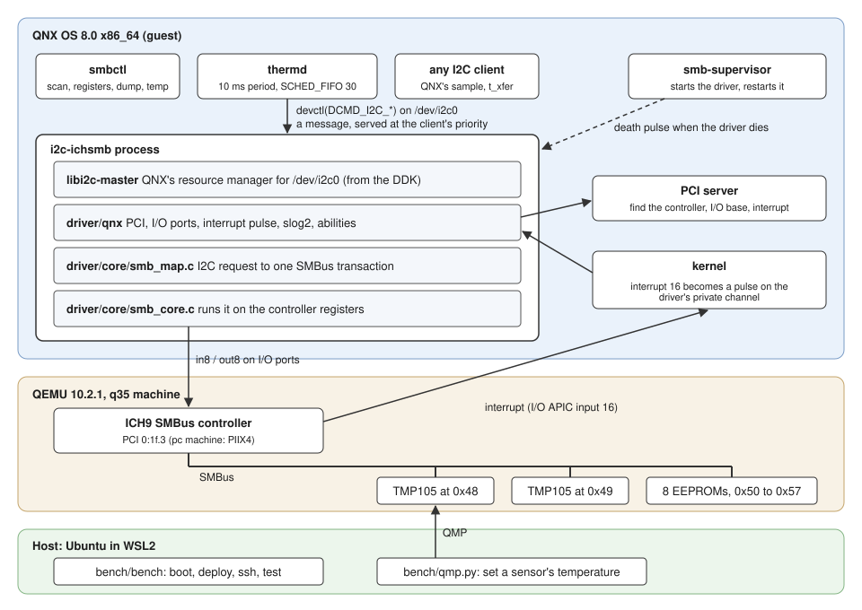

# Design



## Layers

```
client (smbctl, t_xfer, any program using the I2C devctls)
   |  open("/dev/i2c0"), devctl(DCMD_I2C_SEND / RECV / SENDRECV / ...)
libi2c-master        QNX's resource manager: owns /dev/i2cN, calls the driver table
   |  send(), recv(), xfer(), set_slave_addr(), bus_reset(), ...
driver/qnx           PCI lookup, I/O ports, interrupt, logging, privileges
   |  smb_bus_*()
driver/core/smb_map.c    generic I2C request -> one SMBus transaction
   |  smb_*()
driver/core/smb_core.c   runs the transaction on the controller's registers
   |  in8 / out8 / wait / now callbacks
hardware (or QEMU's model, or the software model in tests/host)
```

`driver/core` has no operating-system calls. Everything it needs from the outside comes through five callbacks, which is why the same code runs under QNX, on bare metal in QEMU and against the software model on a PC.

## Mapping I2C requests to SMBus

An I2C client asks for raw bytes: "write these n bytes", "read n bytes", "write, then read without releasing the bus". The chipset controller can't put arbitrary bytes on the wire. It runs a fixed set of SMBus transaction types, each with its own shape. `smb_map.c` picks the one transaction whose bytes on the wire are exactly the bytes the client asked for. If none matches, the request is refused with an error. It is never replaced by something that only looks similar.

| Write phase | Read phase | SMBus transaction | Controller needs |
|---|---|---|---|
| 0 bytes | 0 | Quick (write) | |
| 1 | 0 | Send Byte | |
| 2 | 0 | Write Byte Data | |
| 3 | 0 | Write Word Data | |
| 4 to 33 | 0 | block write, no count byte | I2C framing (ICH, I2C_EN set) |
| 4 to 34 | 0 | SMBus Block Write, see note 1 | block support |
| 0 | 1 | Receive Byte | |
| 1 | 1 | Read Byte Data | |
| 1 | 2 | Read Word Data | |
| 1 | 3 to 32 | I2C Block Read | ICH |
| 1 | 2 to 33 | SMBus Block Read, see note 2 | block support, `-s` |
| anything else | | refused | |

1. Only when the controller adds the count byte itself (I2C_EN clear, `-s`) and the request's second byte already equals the number of bytes after it. The request then is a well-formed SMBus block write.
2. Only with `-s`. The client's buffer receives the count byte first, then the data, which is what a raw I2C master would see.

### Addresses

Only 7-bit addresses from 0x08 to 0x77 are accepted. 0x00 to 0x07 and 0x78 to 0x7F are reserved by I2C, and 0x00 is the general call, which every chip on the bus takes. Before 20 Nov a Send Byte to 0x00 went out; on QEMU it moved the register pointer of both sensors and of the three EEPROMs checked (0x50, 0x53, 0x57), so their next plain read returned the wrong register. `smb_bus_set_addr()` now refuses the reserved range, and the client sees `EIO` with no status bit set (`smbctl` says "refused by the driver"). Tested in `tests/cases/30-errors.json`.

### SMBus block versus I2C block

An SMBus Block Write puts a count byte on the wire after the command byte; an I2C block write doesn't. An SMBus Block Read expects the device to send a count byte first; an I2C Block Read reads a fixed number of bytes. Most I2C chips (EEPROMs, sensors) want the I2C forms, so they are the default. `-s` switches the controller and the mapping to the SMBus forms, for SMBus devices that use them.

### Write then read

The controller can't hold the bus between two separate commands. It can only do "write, repeated start, read" as one transaction (Read Byte Data, Read Word Data, the block reads). The driver therefore sets `I2C_CAPS_FORCE_STOP` in its driver info. libi2c-master then hands a write-then-read request (`DCMD_I2C_SENDRECV`) to `xfer()` as one call, and refuses a send without stop with `ENOTSUP`. The core also has a fallback for frameworks that call `send(no stop)` and then `recv()`: the send is held, nothing goes on the bus, and the two are combined when the receive arrives.

## Errors

| Controller result | Core result | Status to the library | Client sees |
|---|---|---|---|
| DEV_ERR (no acknowledge) | `SMB_E_NACK` | DONE \| NACK | `EIO`, status NACK |
| BUS_ERR (collision) | `SMB_E_BUS` | DONE \| ARBL | `EIO`, status ARBL |
| no completion within the timeout | `SMB_E_TIMEOUT` (transaction killed) | DONE \| BUSY | `EIO`, status BUSY |
| HOST_BUSY at start (firmware owns it) | `SMB_E_BUSY` | DONE \| BUSY | `EIO`, status BUSY |
| FAILED (killed) | `SMB_E_ABORTED` | DONE \| ABORT | `EIO`, status ABORT |
| request not expressible, bad block count | `SMB_E_UNSUPPORTED`, `SMB_E_PROTO` | DONE \| ERROR | `EIO`, status ERROR |

libi2c-master counts a call as successful only when the driver returns exactly `I2C_STATUS_DONE`. That comes from its `check_mstatus()`, read from the disassembly because the documentation only says "returns one of". Every error is therefore `DONE` plus the cause.

After any error the controller is left idle with its status cleared, so the next request works. The tests check this 1000 times in a row in each mode. A transaction that doesn't finish is killed, and so is one where the controller keeps asking for block bytes past the 32-byte limit. QEMU's model does that on 32-byte block writes (see DEVLOG, 19 Nov).

## Interrupt mode (`-i`, `-I irq`)

The driver attaches the controller's PCI interrupt with `InterruptAttachEvent()`, delivering a pulse to a private channel. While a transaction runs, the core sleeps in `MsgReceivePulse()` with a timeout instead of polling.

### Which interrupt

`-i` takes the interrupt number from the PCI server. On QEMU's q35 machine that number is wrong. The PCI server's routing table (`pci_hw.cfg` in the image) has no entry for the SMBus function 0:1f.3, so it reports 10, the legacy PIC line the BIOS wrote into config space. QNX runs the I/O APIC, and QEMU delivers the controller's interrupt (PIRQA) on I/O APIC input 16. I found that by attaching each candidate in turn and running one transaction by hand: only 16 fired.

`-I 16` gives the number directly. On a real system the better fix is a routing entry for the controller in the PCI server's configuration; `-I` is for when that's missing.

Until 19 Nov the driver attached 10 and never got an interrupt, and nothing said so: QEMU's model never made it wait (see below), so every test passed. Now the driver logs "first interrupt received" once, or a warning if 20 transactions go by without one. Both messages are tested (`tests/cases/55-interrupts.json`).

### Masking

The kernel masks the line each time it delivers the event, and the driver unmasks it exactly once per delivery. The order matters:

1. read the status register;
2. handle the event and clear its status bits, which lowers the line;
3. only then unmask (`q_irq_done()`);
4. wait for the next pulse.

If the controller raises the line again between steps 1 and 4, the pulse is already queued on the channel and the wait returns at once, so no interrupt is lost. Because the line stays masked until step 3, at most one pulse can be pending. A stale pulse costs one extra status read and nothing more, since the core always re-reads the status register after a wait.

The event can also be delivered without the driver ever waiting for it, when the transaction is already over at the first status read. QEMU's model does that every time: with interrupts enabled it runs the whole transaction inside the register write that starts it. The pulse then sat on the channel and the line stayed masked from the first transaction on. On real hardware that would also block any other device sharing the line. So before deciding whether to unmask, `q_irq_done()` now collects a pending pulse without blocking.

### Priority

Message passing runs the driver thread at the priority of the client it is serving. But receiving a pulse normally sets the receiving thread to the pulse's priority, and the interrupt pulse arrives at the priority of the thread that attached it, 10. A probe build logged it: a thread serving a priority-30 client was at 10 after the pulse.

Measured with `thermd` at 30 and `hog` spinning at 20 on both processors: the driver, now at 10, got no processor time while `hog` ran. `thermd` sat inside its `devctl()` for 15 seconds, missed 1499 periods and never saw the over-temperature (`docs/results/thermd-inversion-before-fix.txt`).

The interrupt channel is now created with `_NTO_CHF_FIXED_PRIORITY`, so the thread keeps the priority it inherited from the client. Same run after the fix: no period lost, fan on 2.1 ms into the period that saw the temperature. `tests/cases/70-realtime.json` checks this on every run.

### What the timing numbers mean

10,000 two-byte reads in QEMU with KVM (`docs/results/tests-q35.txt`):

| Mode | Time per read | Driver CPU time for the run |
|---|---|---|
| polling | 1304 µs | 3.9 s |
| interrupt | 335 µs | 3.4 s |

Both numbers describe QEMU more than hardware. With interrupts enabled, QEMU finishes the transaction inside the START write, so the time is register traps plus one interrupt. With interrupts off, QEMU reports the controller busy until the first status read, so the polling driver always sleeps once, and QNX rounds the 250 µs sleep up to its 1 ms timer tick. On hardware a word read is about half a millisecond of bus time at 100 kHz in either mode; interrupt mode saves the processor time spent polling and the tick rounding.

Block reads in interrupt mode raise one interrupt per byte, so there they cost more than polling in QEMU.

PIIX4 is polling only.

## Privileges (`-U`)

The driver must start as root to get I/O port access (`ThreadCtl(_NTO_TCTL_IO_LEVEL)`), attach to the PCI device and attach the interrupt. With `-U user`, once that is done `init()`:

1. allows and locks, for the non-root domain, only what is still needed: `PATHSPACE` (libi2c-master registers `/dev/i2cN` after `init()` returns), `PUBLIC_CHANNEL` (the library's channel), and `INTERRUPT` in interrupt mode;
2. switches to the user with `set_ids_from_arg()`;
3. denies and locks every other ability, for root and non-root.

I/O port access stays with the thread that `ThreadCtl()` granted it to. The tests check that the driver runs as uid 1000 and that every transfer type still works. They also check that starting it directly as a normal user fails at once with "no I/O privilege ... start as root, then use -U to drop to a user".

## Logging

Messages go through the library's `i2c_slogf()`, which calls `vslogf()`. On QNX 8 that reaches slog2 only when the process has set a default slog2 buffer, so `init()` registers a buffer set named `i2c_ichsmb` first. Read it with `slog2info -b i2c_ichsmb`. (Until 19 Nov it didn't, and every message was dropped; I noticed while chasing the interrupt.) By default only warnings and errors are logged; each `-v` adds a level. During start-up the same messages also go to stderr, so whoever starts the driver sees why it failed. The library logs every failed transfer at error level when its verbosity allows. The driver reports a low verbosity to it unless `-v` is given, so that a bus scan doesn't flood the log with expected NACKs.

## Starting the driver

libi2c-master turns the process into a daemon with `procmgr_daemon(0, PROCMGR_DAEMON_NOCLOSE | PROCMGR_DAEMON_NODEVNULL)`, so standard input, output and error stay open. Started from a startup script that's fine. Started over SSH, give it `</dev/null >/dev/null 2>&1`, or the SSH session stays open.

Stopping the driver with `slay` ends the process without calling its `fini()`, so the closing summary (transactions, errors, interrupts) doesn't get logged then.

## References

Everything here was written from public documents. No code was copied from another SMBus driver.

- Intel I/O Controller Hub 9 (ICH9) Family Datasheet, chapter "SMBus Controller Registers (D31:F3)".
- Intel 82371AB PCI-to-ISA/IDE Xcelerator (PIIX4) Datasheet, chapter "SMBus I/O Space Registers".
- QNX I2C Driver Development Kit: https://www.qnx.com/developers/docs/qnxeverywhere/com.qnx.doc.ddk/topic/i2c/driver_I2C.html, with `driver_I2C_implementation.html` and `I2C_example.html` next to it.
- I2C framework function table: https://www.qnx.com/developers/docs/8.0/com.qnx.doc.neutrino.custom_bsp/topic/i2c/i2c_framework_Function_table.html
- PCI server library: https://www.qnx.com/developers/docs/8.0/com.qnx.doc.pci_server/topic/library.html
- QNX 8.0 C library reference for `ThreadCtl()`, `mmap_device_io()`, `InterruptAttachEvent()`, `ChannelCreate()`, `procmgr_ability()` and `slog2_register()`.
- The installed headers `<hw/i2c.h>` and `<pci/pci.h>`, for what the pages above leave open (listed in DEVLOG, 14 Nov).
- QEMU's controller model, `hw/i2c/pm_smbus.c`, read to explain its timing and to find the block-write bug. It is GPL code and only used as a test target; none of it is in this repository.
